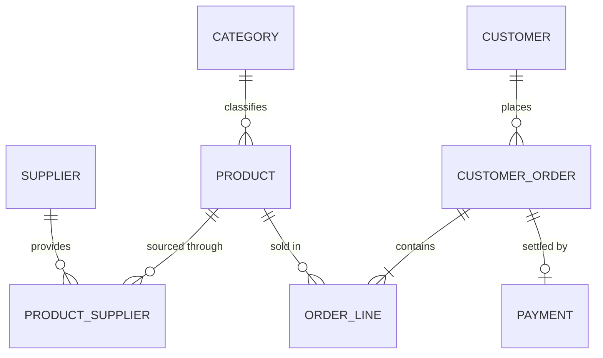

# Wholesale Order and Stock Management API

DS1 project for the Web Development course: a REST API built with Spring Boot, Spring Data JPA and MySQL.

## Business context

A wholesale distributor buys products from suppliers and sells them to business customers. The application manages the catalogue, stock levels, customer orders and payments, and provides business reports for restocking, revenue, best sellers and overdue customers.

## Technologies

| Purpose | Technology |
|---|---|
| Language | Java 21 |
| Framework | Spring Boot 4.1.2 (Web MVC, Data JPA, Validation) |
| Database | MySQL 8.4 |
| Automated tests | JUnit, MockMvc, H2 in-memory database |
| API testing | Postman |
| Boilerplate reduction | Lombok |

## Architecture

```text
Client (Postman)
    |  JSON
Controller   receives requests, validates input, returns HTTP status codes
    |  DTO
Service      business rules and transactions
    |  Entity
Repository   Spring Data JPA and custom queries
    |
MySQL
```

```text
src/main/java/com/rayen/springds1/
├─ model/         JPA entities
│  └─ enums/      OrderStatus, PaymentMethod, PaymentStatus
├─ repository/    data access and custom queries
├─ service/       business logic
├─ controller/    REST endpoints
├─ dto/           request and response objects
└─ exception/     custom exceptions and global error handler
```

Controllers exchange DTOs, never JPA entities. This prevents infinite JSON loops on two-way relationships, avoids lazy-loading errors, and stops clients from setting fields such as prices, totals or statuses.

## Entities

| Entity | Purpose | Main fields |
|---|---|---|
| `Category` | Groups products | name, description |
| `Supplier` | Company that restocks products | name, email, phone, city |
| `Product` | Sellable item and its stock | sku, name, unitPrice, stockQuantity, reorderLevel, active |
| `Customer` | Business account placing orders | companyName, email, phone, address, city, createdAt |
| `CustomerOrder` | One sale and its lifecycle | orderNumber, orderDate, status, totalAmount |
| `OrderLine` | One product on one order | quantity, unitPrice |
| `Payment` | Settlement of an order | amount, method, status, paidAt |



| Relationship | Type | Owning side |
|---|---|---|
| Category and Product | `@OneToMany` / `@ManyToOne` | Product |
| Product and Supplier | `@ManyToMany` through table `product_supplier` | Product |
| Customer and CustomerOrder | `@OneToMany` / `@ManyToOne` | CustomerOrder |
| CustomerOrder and OrderLine | `@OneToMany` / `@ManyToOne`, cascade and orphan removal | OrderLine |
| Product and OrderLine | `@ManyToOne`, one-directional | OrderLine |
| CustomerOrder and Payment | `@OneToOne`, unique foreign key | Payment |

## Business rules

- Creating an order checks and reduces stock. If one line fails, the whole order is cancelled and no stock changes.
- Each order line keeps the product price at the time of sale, so later price changes do not alter past orders.
- The order total is always calculated by the server.
- Lines and the customer of an order can change only while it is `PENDING`.
- A payment must equal the order total, and each order can have only one payment.
- A product that appears in an order cannot be deleted; it is set to `active: false` instead.
- Categories with products and customers with orders cannot be deleted.
- Deleting a supplier removes it from its products; the products are kept.
- A payment can be deleted only while its order is `PAID`, which returns the order to `PENDING`.
- Only a `CANCELLED` order with no payment can be deleted.

Allowed order status changes:

| From | To | How |
|---|---|---|
| `PENDING` | `PAID` | Creating a payment only |
| `PENDING` | `CANCELLED` | Status update; stock is restored |
| `PAID` | `SHIPPED` | Status update |
| `PAID` | `CANCELLED` | Status update; stock is restored and the payment becomes `REFUNDED` |
| `SHIPPED` | `DELIVERED` | Status update |

## Endpoints

### CRUD

| Resource | Base URL | Operations |
|---|---|---|
| Categories | `/api/categories` | `GET`, `GET /{id}`, `POST`, `PUT /{id}`, `DELETE /{id}` |
| Suppliers | `/api/suppliers` | `GET`, `GET /{id}`, `POST`, `PUT /{id}`, `DELETE /{id}` |
| Customers | `/api/customers` | `GET`, `GET /{id}`, `POST`, `PUT /{id}`, `DELETE /{id}` |
| Products | `/api/products` | `GET`, `GET /{id}`, `POST`, `PUT /{id}`, `DELETE /{id}` |
| Orders | `/api/orders` | `GET`, `GET /{id}`, `POST`, `PUT /{id}`, `DELETE /{id}` |
| Payments | `/api/payments` | `GET`, `GET /{id}`, `POST`, `PUT /{id}`, `DELETE /{id}` |

### Additional order endpoints

| Method | URL | Purpose |
|---|---|---|
| `GET` | `/api/orders/customer/{customerId}` | Orders of one customer |
| `PATCH` | `/api/orders/{id}/status` | Change the order status |
| `GET` | `/api/orders/{id}/lines` | List order lines |
| `POST` | `/api/orders/{id}/lines` | Add a line |
| `PUT` | `/api/orders/{id}/lines/{lineId}` | Change a line quantity |
| `DELETE` | `/api/orders/{id}/lines/{lineId}` | Remove a line |

### Reports (custom queries)

| Business question | Endpoint |
|---|---|
| Which active products must be restocked? | `GET /api/reports/reorder-needed` |
| How much money was received in a period? | `GET /api/reports/revenue?from=2026-01-01&to=2026-12-31` |
| Which products sold the most units? | `GET /api/reports/best-sellers?from=2026-01-01&to=2026-12-31&limit=10` |
| Which customers have old unpaid orders? | `GET /api/reports/overdue-customers?days=30` |

### Status codes and errors

| Code | Meaning |
|---|---|
| `200` / `201` / `204` | Success / created / deleted |
| `400` | Invalid data or parameters |
| `404` | Resource or URL not found |
| `405` / `415` | HTTP method or content type not supported |
| `409` | Business rule or duplicate conflict |

All errors use the same format:

```json
{
  "timestamp": "2026-11-10T10:15:30Z",
  "status": 409,
  "error": "Conflict",
  "message": "Insufficient stock for product LAP-1: requested 9, available 1",
  "path": "/api/orders"
}
```

## How to run

**Requirements:** JDK 21 and MySQL 8 running on port 3306. The database `spring_ds1` is created automatically.

The MySQL password is read from an environment variable so that it is never stored in the repository. In PowerShell, from the project folder:

```powershell
$s = Read-Host "MySQL password" -AsSecureString
$env:MYSQL_PASSWORD = [Runtime.InteropServices.Marshal]::PtrToStringBSTR([Runtime.InteropServices.Marshal]::SecureStringToBSTR($s))
.\mvnw.cmd spring-boot:run
```

The API is then available at `http://localhost:8080`.

| Optional variable | Default |
|---|---|
| `MYSQL_HOST` | `127.0.0.1` |
| `MYSQL_PORT` | `3306` |
| `MYSQL_DATABASE` | `spring_ds1` |
| `MYSQL_USERNAME` | `root` |

## Testing

**Automated tests** use an in-memory H2 database, so they do not need MySQL:

```powershell
.\mvnw.cmd clean test
```

**Postman:** import [`postman/DS1-Wholesale-API.postman_collection.json`](postman/DS1-Wholesale-API.postman_collection.json), start the application, and run the whole collection in order with the Collection Runner. Each request stores the ids used by the following ones, and every run uses unique names, so it can be repeated. It contains 106 requests covering success and error cases.
